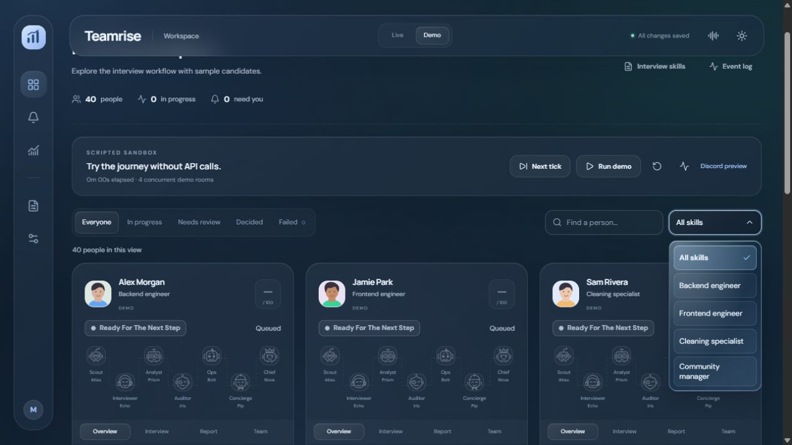

<div align="center">

# Teamrise

**A local workspace for AI interviews, from the first question to human review.**

Create role-specific interviews, run them in the browser or in Discord, and review the evidence alongside the conversation.

[Quick start](#quick-start) · [Live interviews](#live-interviews) · [Discord voice](VOICE-SETUP.md)

</div>



## What you can do

- **Try the workflow without credentials.** The scripted Demo includes sample candidates, an event log, a review queue, and a Discord message preview.
- **Design an interview.** Combine a role prompt, ordered questions, practical tasks with optional screenshots, and assessment criteria. Each interview keeps the skill version it started with.
- **Interview in the browser or in Discord.** A person types the candidate's answers in a web interview. In Discord, the bot asks questions aloud in a private voice room and posts written tasks in the room chat.
- **Review the evidence.** Read the transcript and AI assessment, inspect the candidate quotes behind the scores, and record a human decision. Usage is tracked by interview and AI role when the provider reports it.

## Quick start

The Windows build requires **Git**, **Go 1.26+**, **Node.js 22.12+** with npm, and **PowerShell**. The build downloads dependencies. Demo mode needs no AI account, Discord bot, or Python.

```powershell
git clone https://github.com/0xMooncalf/teamrise.git
cd teamrise
powershell -ExecutionPolicy Bypass -File .\Build.ps1
.\Start-Teamrise.cmd
```

The build runs the frontend build and Go checks, then produces a single executable with the dashboard embedded. Open [Teamrise](http://127.0.0.1:8083/) if the browser does not open automatically. Keep the terminal running while you use the app.

Choose **Demo → Run demo** to watch the scripted workflow, or **Next tick** to step through it. Open a candidate card to see the interview, report, and team views.

## Live interviews

1. Open **Connections & agents → AI provider**. Choose an OpenAI-compatible endpoint and enter its base URL, model ID, and any required API key. Alternatively, use **Codex subscription** with a compatible native Codex client already signed in to ChatGPT on this computer.
2. Use **Save settings** to apply the configuration. **Save & test** sends a real request to the selected provider.
3. Open **Interview skills** and choose a preset or save your own prompt, questions, and criteria.
4. In **Live**, choose **New interview → Begin interview**. Enter the candidate's answers as they respond. Open **Assessment** and **Usage** to review the result.

For Discord interviews, install the optional local speech runtime and connect your own bot. The setup guide covers the required permissions, slash commands, and reconnect behavior. [Discord bot setup](DISCORD-SETUP.md) · [Voice installation and use](VOICE-SETUP.md)

## Where your data lives

Teamrise binds to localhost. The local journal in \`data/\` contains transcripts, assessments, and usage. Connection settings are stored separately from session credentials. Discord bot tokens and provider API keys are kept in memory and entered again after restart.

Discord speech recognition and synthesis run locally. Live text inference sends the skill and transcript to the configured AI provider. The current Discord integration handles one live voice interview at a time. Review queues are shared by tabs connected to the same local instance.

## Build and test

The browser UI lives in [\`web/\`](web), the Go server and interview pipeline in [\`internal/\`](internal), and the optional Node/Python voice worker in [\`voice/\`](voice). Build the frontend before running Go tests or building the server directly because Go embeds the generated dashboard.

```powershell
npm.cmd --prefix web ci
npm.cmd --prefix web run build
go test ./...
go vet ./...
go build -o teamrise.exe ./cmd/ladder
```

Third-party dependencies and fonts retain their own licenses. [Third-party notices](THIRD_PARTY_NOTICES.txt) · [Voice dependency notices](VOICE-NOTICES.txt)
